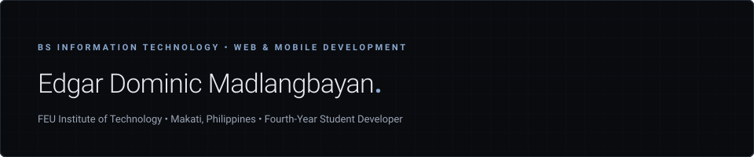
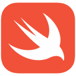
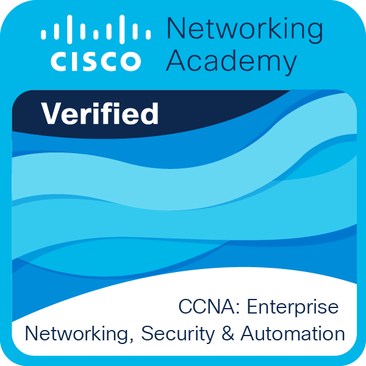
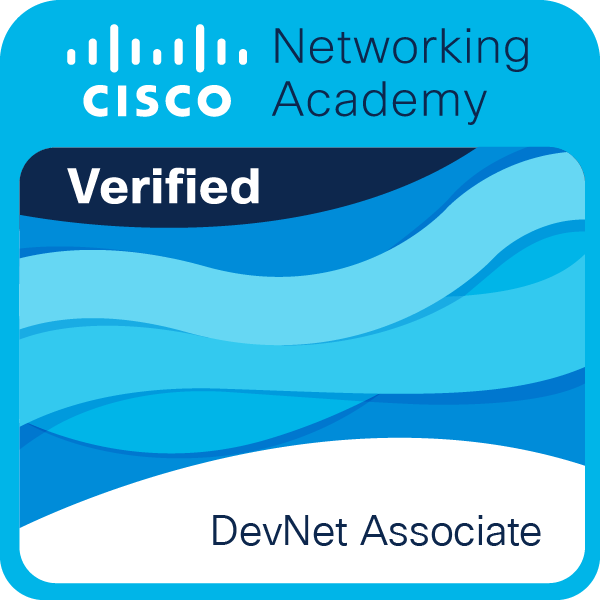
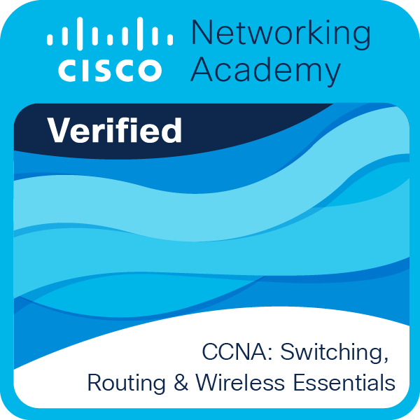
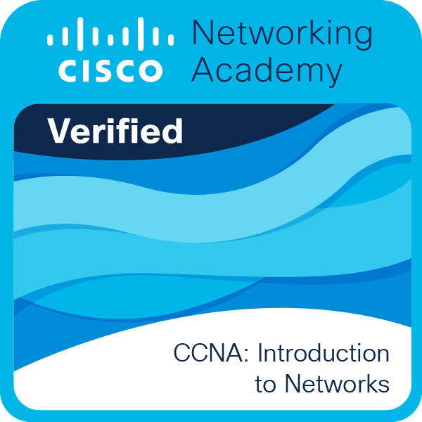
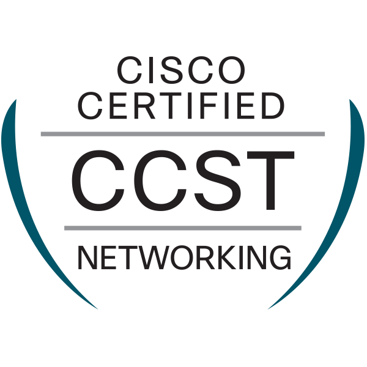
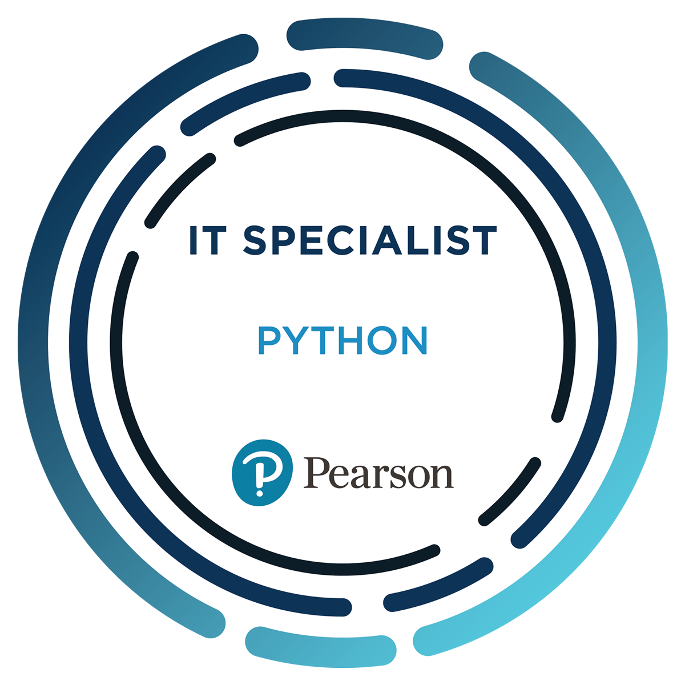
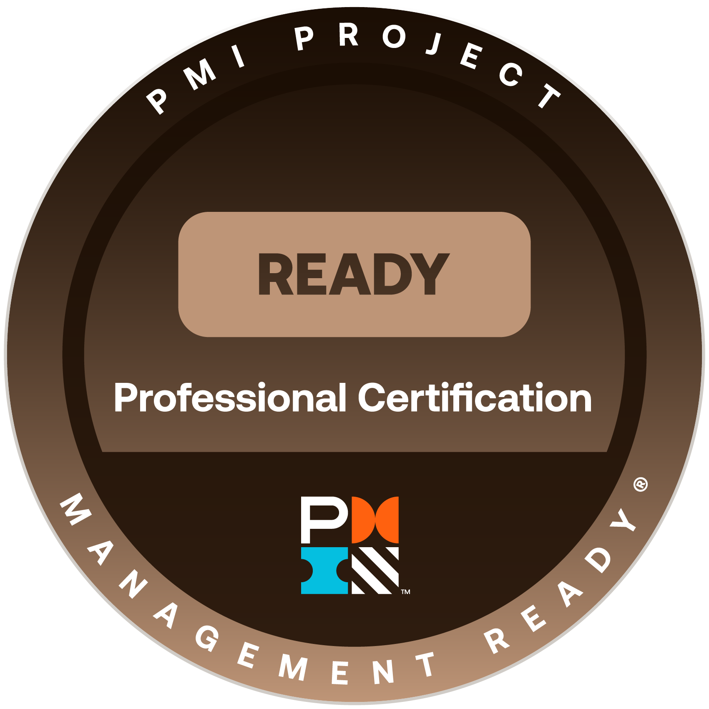

<picture>
  <source media="(prefers-color-scheme: dark)" srcset="assets/images/header-dark.svg">
  <source media="(prefers-color-scheme: light)" srcset="assets/images/header-light.svg">
  
</picture>

## About Me

I am a fourth-year Bachelor of Science in Information Technology student at **FEU Institute of Technology**, specializing in **Web and Mobile Application Development** and based in **Makati, Philippines**.

My development experience centers on backend engineering, RESTful API design, and database systems, alongside building clean, responsive user interfaces for web and mobile platforms. I value clear system architecture, practical problem solving, and seeing projects through from schema planning to implementation.

---

## Skills & Technologies

### Programming Languages

<table width="100%">
  <tr>
    <td width="25%" nowrap align="left">&nbsp;JavaScript</td>
    <td width="25%" nowrap align="left">&nbsp;TypeScript</td>
    <td width="25%" nowrap align="left">&nbsp;PHP</td>
    <td width="25%" nowrap align="left">&nbsp;Python</td>
  </tr>
  <tr>
    <td width="25%" nowrap align="left">&nbsp;C++</td>
    <td width="25%" nowrap align="left">&nbsp;Java</td>
    <td width="25%" nowrap align="left">&nbsp;Kotlin</td>
    <td width="25%" nowrap align="left">&nbsp;Swift</td>
  </tr>
</table>

### Frontend Development

<table width="100%">
  <tr>
    <td width="33.3%" nowrap align="left">&nbsp;HTML5</td>
    <td width="33.3%" nowrap align="left">&nbsp;CSS3</td>
    <td width="33.3%" nowrap align="left">&nbsp;React</td>
  </tr>
  <tr>
    <td width="33.3%" nowrap align="left">&nbsp;Tailwind&nbsp;CSS</td>
    <td width="33.3%" nowrap align="left">&nbsp;Bootstrap</td>
    <td width="33.3%" nowrap align="left"><picture><source media="(prefers-color-scheme: dark)" srcset="assets/icons/skills/shadcnui-dark.svg"><source media="(prefers-color-scheme: light)" srcset="assets/icons/skills/shadcnui-light.svg"></picture>&nbsp;shadcn/ui</td>
  </tr>
</table>

### Backend Development

<table width="100%">
  <tr>
    <td width="20%" nowrap align="left">&nbsp;Node.js</td>
    <td width="22%" nowrap align="left"><picture><source media="(prefers-color-scheme: dark)" srcset="assets/icons/skills/express-dark.svg"><source media="(prefers-color-scheme: light)" srcset="assets/icons/skills/express-light.svg"></picture>&nbsp;Express.js</td>
    <td width="23%" nowrap align="left">&nbsp;CodeIgniter</td>
    <td width="35%" nowrap align="left"><picture><source media="(prefers-color-scheme: dark)" srcset="assets/icons/skills/network-dark.svg"><source media="(prefers-color-scheme: light)" srcset="assets/icons/skills/network-light.svg"></picture>&nbsp;RESTful&nbsp;API&nbsp;Development</td>
  </tr>
</table>

### Databases & Backend Services

<table width="100%">
  <tr>
    <td width="20%" nowrap align="left">&nbsp;MySQL</td>
    <td width="20%" nowrap align="left">&nbsp;MongoDB</td>
    <td width="20%" nowrap align="left">&nbsp;Redis</td>
    <td width="20%" nowrap align="left">&nbsp;Supabase</td>
    <td width="20%" nowrap align="left">&nbsp;Firebase</td>
  </tr>
</table>

### Tools & Platforms

<table width="100%">
  <tr>
    <td width="25%" nowrap align="left">&nbsp;Google&nbsp;Cloud</td>
    <td width="25%" nowrap align="left">&nbsp;Git</td>
    <td width="25%" nowrap align="left"><picture><source media="(prefers-color-scheme: dark)" srcset="assets/icons/skills/github-dark.svg"><source media="(prefers-color-scheme: light)" srcset="assets/icons/skills/github-light.svg"></picture>&nbsp;GitHub</td>
    <td width="25%" nowrap align="left">&nbsp;Docker</td>
  </tr>
  <tr>
    <td width="25%" nowrap align="left"><picture><source media="(prefers-color-scheme: dark)" srcset="assets/icons/skills/vercel-dark.svg"><source media="(prefers-color-scheme: light)" srcset="assets/icons/skills/vercel-light.svg"></picture>&nbsp;Vercel</td>
    <td width="25%" nowrap align="left"><picture><source media="(prefers-color-scheme: dark)" srcset="assets/icons/skills/render-dark.svg"><source media="(prefers-color-scheme: light)" srcset="assets/icons/skills/render-light.svg"></picture>&nbsp;Render</td>
    <td width="50%" nowrap align="left" colspan="2">&nbsp;Photoshop</td>
  </tr>
</table>

---

## Featured Work

### ISKKOLAR: Scholarship Application and Management System

**ISKKOLAR** is a comprehensive capstone system engineered for **Kapatiran-Kaunlaran Foundation Inc. (KKFI)** to streamline scholarship admissions, scholar monitoring, and administrative compliance.

#### ISKKOLAR Web

- **Year:** 2026
- **Role:** Backend Developer
- **Focus:** Scholarship management and applicant portal
- **System Capabilities:**
  - Facilitates digital scholarship application workflows and records management.
  - Monitors document compliance and tracks financial assistance disbursements.
  - Utilizes Optical Character Recognition (OCR) and Natural Language Processing (NLP) to extract, process, and validate text from submitted scholarship documentation, reducing manual verification overhead.
- **Deployment:** [kkfi-iskkolar.org](https://www.kkfi-iskkolar.org)

<table width="100%">
  <tr>
    <td width="50%" align="center">
      
       
      <b>Portal Interface:</b> Scholarship Application Workflow
    </td>
    <td width="50%" align="center">
      
       
      <b>Admin Dashboard:</b> Scholar Records & Compliance Monitoring
    </td>
  </tr>
</table>

#### ISKKOLAR Mobile

- **Year:** 2026
- **Role:** Backend Developer
- **Focus:** Cross-platform companion mobile application
- **System Capabilities:**
  - Serves as the dedicated mobile counterpart to the web application.
  - Gives scholars and applicants direct access to application statuses, announcements, compliance requirements, and profile management from mobile devices.

<table width="100%">
  <tr>
    <td width="50%" align="center">
      
       
      <b>Mobile Interface:</b> Application &amp; Authentication Flow
    </td>
    <td width="50%" align="center">
      
       
      <b>Scholar Portal:</b> Mobile Access to System Features
    </td>
  </tr>
</table>

---

## Certifications

Click any badge below to view the verified credential record on Credly:

<table width="100%">
  <tr>
    <td width="25%" align="center" valign="top">
      <a href="https://www.credly.com/badges/861c241c-6720-46c3-8d1c-9f34ec830ceb/public_url" target="_blank" rel="noopener noreferrer">
         
        <b>CCNA: Enterprise Networking, Security, and Automation</b>
      </a> 
      Cisco &bull; Jan 2026
    </td>
    <td width="25%" align="center" valign="top">
      <a href="https://www.credly.com/badges/ba91d8c5-2a38-49cb-8821-70a7cdea9af1/public_url" target="_blank" rel="noopener noreferrer">
         
        <b>DevNet Associate</b>
      </a> 
      Cisco &bull; Apr 2026
    </td>
    <td width="25%" align="center" valign="top">
      <a href="https://www.credly.com/badges/84f0f665-c3bb-4d64-905d-643bd9bd245a/public_url" target="_blank" rel="noopener noreferrer">
         
        <b>CCNA: Switching, Routing, and Wireless Essentials</b>
      </a> 
      Cisco &bull; Mar 2025
    </td>
    <td width="25%" align="center" valign="top">
      <a href="https://www.credly.com/badges/2ce6e773-36a8-4cf8-9c0c-565c06e155ee/public_url" target="_blank" rel="noopener noreferrer">
         
        <b>CCNA: Introduction to Networks</b>
      </a> 
      Cisco &bull; Feb 2025
    </td>
  </tr>
  <tr>
    <td width="25%" align="center" valign="top">
      <a href="https://www.credly.com/badges/cb93bcfd-5972-45c4-a631-b722084fd1d4/public_url" target="_blank" rel="noopener noreferrer">
         
        <b>CCST Networking</b>
      </a> 
      Cisco &bull; Feb 2025
    </td>
    <td width="25%" align="center" valign="top">
      <a href="https://www.credly.com/badges/63f274f6-ab7f-4a00-afe2-99876d933110/public_url" target="_blank" rel="noopener noreferrer">
         
        <b>IT Specialist: Databases</b>
      </a> 
      Certiport &bull; Nov 2024
    </td>
    <td width="25%" align="center" valign="top">
      <a href="https://www.credly.com/badges/c8fda493-1b18-4e71-98fb-c1599e437e33/public_url" target="_blank" rel="noopener noreferrer">
         
        <b>IT Specialist: Python</b>
      </a> 
      Certiport &bull; Feb 2025
    </td>
    <td width="25%" align="center" valign="top">
      <a href="https://www.credly.com/badges/5f470c72-26a0-4b5a-9814-e36b5b2a0a8e/public_url" target="_blank" rel="noopener noreferrer">
         
        <b>PMI Project Management Ready™</b>
      </a> 
      PMI &bull; Active thru 2031
    </td>
  </tr>
</table>

---

## Contact & Profiles

<table width="100%">
  <tr>
    <td width="50%" nowrap align="left">
      <picture>
        <source media="(prefers-color-scheme: dark)" srcset="assets/icons/contact/mail-dark.svg">
        <source media="(prefers-color-scheme: light)" srcset="assets/icons/contact/mail-light.svg">
        
      </picture>&nbsp;<b>Personal Email:</b> <a href="mailto:domadlangbayan@gmail.com">domadlangbayan@gmail.com</a>
    </td>
    <td width="50%" nowrap align="left">
      <picture>
        <source media="(prefers-color-scheme: dark)" srcset="assets/icons/contact/graduation-cap-dark.svg">
        <source media="(prefers-color-scheme: light)" srcset="assets/icons/contact/graduation-cap-light.svg">
        
      </picture>&nbsp;<b>Academic Email:</b> <a href="mailto:eamadlangbayan@fit.edu.ph">eamadlangbayan@fit.edu.ph</a>
    </td>
  </tr>
  <tr>
    <td width="50%" nowrap align="left">
      &nbsp;<b>LinkedIn:</b> <a href="https://www.linkedin.com/in/domadla/" target="_blank" rel="noopener noreferrer">Dominic Madlangbayan</a>
    </td>
    <td width="50%" nowrap align="left">
      <picture>
        <source media="(prefers-color-scheme: dark)" srcset="assets/icons/skills/github-dark.svg">
        <source media="(prefers-color-scheme: light)" srcset="assets/icons/skills/github-light.svg">
        
      </picture>&nbsp;<b>GitHub:</b> <a href="https://github.com/domadla" target="_blank" rel="noopener noreferrer">@domadla</a>
    </td>
  </tr>
  <tr>
    <td width="50%" nowrap align="left">
      &nbsp;<b>Facebook:</b> <a href="https://www.facebook.com/domadla" target="_blank" rel="noopener noreferrer">Dominic Madlangbayan</a>
    </td>
    <td width="50%" nowrap align="left">
      <picture>
        <source media="(prefers-color-scheme: dark)" srcset="assets/icons/contact/map-pin-dark.svg">
        <source media="(prefers-color-scheme: light)" srcset="assets/icons/contact/map-pin-light.svg">
        
      </picture>&nbsp;<b>Location:</b> Makati, Philippines
    </td>
  </tr>
</table>
