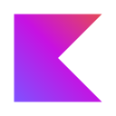
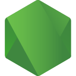
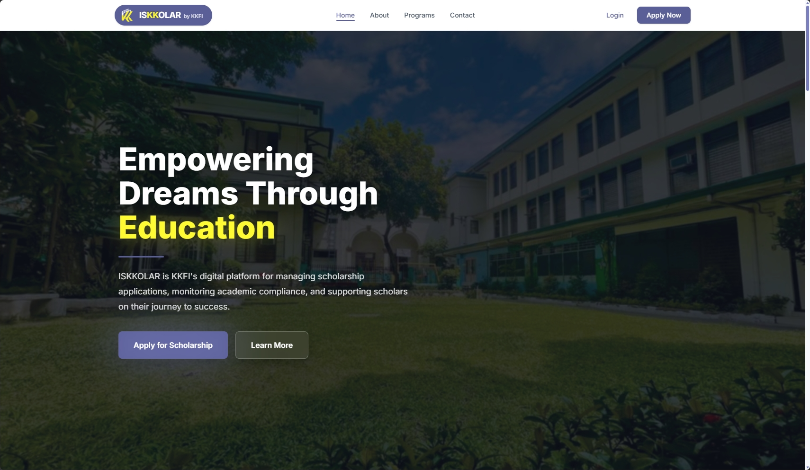
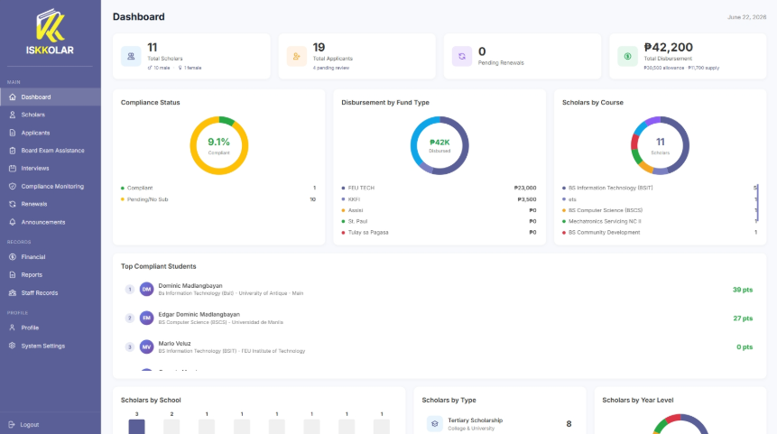
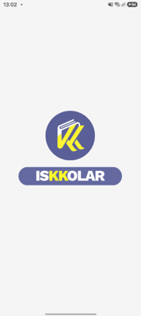
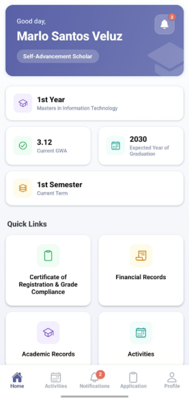

## About Me

I am a fourth-year Bachelor of Science in Information Technology student at **FEU Institute of Technology**, specializing in **Web and Mobile Application Development** and based in **Makati, Philippines**.

My development experience centers on backend engineering, RESTful API design, and database systems, alongside building clean, responsive user interfaces for web and mobile platforms. I value clear system architecture, practical problem solving, and seeing projects through from schema planning to implementation.

---

## Skills & Technologies

### Programming Languages

<table>
  <tr>
    <td width="25%" align="left">&nbsp; JavaScript</td>
    <td width="25%" align="left">&nbsp; TypeScript</td>
    <td width="25%" align="left">&nbsp; PHP</td>
    <td width="25%" align="left">&nbsp; Python</td>
  </tr>
  <tr>
    <td width="25%" align="left">&nbsp; C++</td>
    <td width="25%" align="left">&nbsp; Java</td>
    <td width="25%" align="left">&nbsp; Kotlin</td>
    <td width="25%" align="left">&nbsp; Swift</td>
  </tr>
</table>

### Frontend Development

<table>
  <tr>
    <td width="33.3%" align="left">&nbsp; HTML5</td>
    <td width="33.3%" align="left">&nbsp; CSS3</td>
    <td width="33.3%" align="left">&nbsp; React</td>
  </tr>
  <tr>
    <td width="33.3%" align="left">&nbsp; Tailwind CSS</td>
    <td width="33.3%" align="left">&nbsp; Bootstrap</td>
    <td width="33.3%" align="left">
      <picture>
        <source media="(prefers-color-scheme: dark)" srcset="assets/icons/skills/shadcnui-dark.svg">
        <source media="(prefers-color-scheme: light)" srcset="assets/icons/skills/shadcnui-light.svg">
        
      </picture>&nbsp; shadcn/ui
    </td>
  </tr>
</table>

### Backend Development

<table>
  <tr>
    <td width="25%" align="left">&nbsp; Node.js</td>
    <td width="25%" align="left">
      <picture>
        <source media="(prefers-color-scheme: dark)" srcset="assets/icons/skills/express-dark.svg">
        <source media="(prefers-color-scheme: light)" srcset="assets/icons/skills/express-light.svg">
        
      </picture>&nbsp; Express.js
    </td>
    <td width="25%" align="left">&nbsp; CodeIgniter</td>
    <td width="25%" align="left">
      <picture>
        <source media="(prefers-color-scheme: dark)" srcset="assets/icons/skills/network-dark.svg">
        <source media="(prefers-color-scheme: light)" srcset="assets/icons/skills/network-light.svg">
        
      </picture>&nbsp; RESTful API Development
    </td>
  </tr>
</table>

### Databases & Backend Services

<table>
  <tr>
    <td width="20%" align="left">&nbsp; MySQL</td>
    <td width="20%" align="left">&nbsp; MongoDB</td>
    <td width="20%" align="left">&nbsp; Redis</td>
    <td width="20%" align="left">&nbsp; Supabase</td>
    <td width="20%" align="left">&nbsp; Firebase</td>
  </tr>
</table>

### Tools & Platforms

<table>
  <tr>
    <td width="25%" align="left">&nbsp; Google Cloud</td>
    <td width="25%" align="left">&nbsp; Git</td>
    <td width="25%" align="left">
      <picture>
        <source media="(prefers-color-scheme: dark)" srcset="assets/icons/skills/github-dark.svg">
        <source media="(prefers-color-scheme: light)" srcset="assets/icons/skills/github-light.svg">
        
      </picture>&nbsp; GitHub
    </td>
    <td width="25%" align="left">&nbsp; Docker</td>
  </tr>
  <tr>
    <td width="25%" align="left">
      <picture>
        <source media="(prefers-color-scheme: dark)" srcset="assets/icons/skills/vercel-dark.svg">
        <source media="(prefers-color-scheme: light)" srcset="assets/icons/skills/vercel-light.svg">
        
      </picture>&nbsp; Vercel
    </td>
    <td width="25%" align="left">
      <picture>
        <source media="(prefers-color-scheme: dark)" srcset="assets/icons/skills/render-dark.svg">
        <source media="(prefers-color-scheme: light)" srcset="assets/icons/skills/render-light.svg">
        
      </picture>&nbsp; Render
    </td>
    <td width="25%" align="left" colspan="2">&nbsp; Photoshop</td>
  </tr>
</table>

---

## Featured Project

### ISKKOLAR: Scholarship Application and Management System

**ISKKOLAR** is a comprehensive capstone system engineered for **Kapatiran-Kaunlaran Foundation Inc. (KKFI)** to streamline scholarship admissions, scholar monitoring, and administrative compliance.

#### ISKKOLAR Web

- **Year:** 2026
- **Role:** Backend Developer
- **Focus:** Scholarship management and applicant portal
- **System Capabilities:**
  - Facilitates digital scholarship application workflows and records management.
  - Monitors document compliance and tracks financial assistance disbursements.
  - Utilizes Optical Character Recognition (OCR) and Natural Language Processing (NLP) to extract, process, and validate text from submitted scholarship documentation, reducing manual verification overhead.
- **Deployment:** [kkfi-iskkolar.org](https://www.kkfi-iskkolar.org)

<table>
  <tr>
    <td width="50%" align="center">
      
       
      <b>Portal Interface:</b> Scholarship Application Workflow
    </td>
    <td width="50%" align="center">
      
       
      <b>Admin Dashboard:</b> Scholar Records & Compliance Monitoring
    </td>
  </tr>
</table>

#### ISKKOLAR Mobile

- **Year:** 2026
- **Role:** Backend Developer
- **Focus:** Cross-platform companion mobile application
- **System Capabilities:**
  - Serves as the dedicated mobile counterpart to the web application.
  - Gives scholars and applicants direct access to application statuses, announcements, compliance requirements, and profile management from mobile devices.

<table>
  <tr>
    <td width="50%" align="center">
      
       
      <b>Mobile Interface:</b> Application &amp; Authentication Flow
    </td>
    <td width="50%" align="center">
      
       
      <b>Scholar Portal:</b> Mobile Access to System Features
    </td>
  </tr>
</table>

---

## Contact & Profiles

<table>
  <tr>
    <td width="50%" align="left">
      <picture>
        <source media="(prefers-color-scheme: dark)" srcset="assets/icons/contact/mail-dark.svg">
        <source media="(prefers-color-scheme: light)" srcset="assets/icons/contact/mail-light.svg">
        
      </picture>
      &nbsp;<b>Personal Email:</b> <a href="mailto:domadlangbayan@gmail.com">domadlangbayan@gmail.com</a>
    </td>
    <td width="50%" align="left">
      <picture>
        <source media="(prefers-color-scheme: dark)" srcset="assets/icons/contact/graduation-cap-dark.svg">
        <source media="(prefers-color-scheme: light)" srcset="assets/icons/contact/graduation-cap-light.svg">
        
      </picture>
      &nbsp;<b>Academic Email:</b> <a href="mailto:eamadlangbayan@fit.edu.ph">eamadlangbayan@fit.edu.ph</a>
    </td>
  </tr>
  <tr>
    <td width="50%" align="left">
      
      &nbsp;<b>LinkedIn:</b> <a href="https://www.linkedin.com/in/domadla/" target="_blank" rel="noopener noreferrer">Dominic Madlangbayan</a>
    </td>
    <td width="50%" align="left">
      <picture>
        <source media="(prefers-color-scheme: dark)" srcset="assets/icons/skills/github-dark.svg">
        <source media="(prefers-color-scheme: light)" srcset="assets/icons/skills/github-light.svg">
        
      </picture>
      &nbsp;<b>GitHub:</b> <a href="https://github.com/domadla" target="_blank" rel="noopener noreferrer">@domadla</a>
    </td>
  </tr>
  <tr>
    <td width="50%" align="left">
      
      &nbsp;<b>Facebook:</b> <a href="https://www.facebook.com/domadla" target="_blank" rel="noopener noreferrer">Dominic Madlangbayan</a>
    </td>
    <td width="50%" align="left">
      <picture>
        <source media="(prefers-color-scheme: dark)" srcset="assets/icons/contact/map-pin-dark.svg">
        <source media="(prefers-color-scheme: light)" srcset="assets/icons/contact/map-pin-light.svg">
        
      </picture>
      &nbsp;<b>Location:</b> Makati, Philippines
    </td>
  </tr>
</table>
